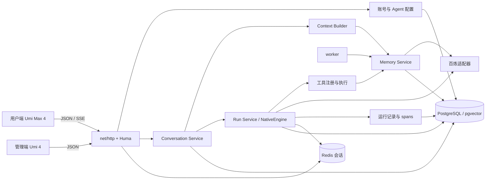

# 当前架构

xa 是 Go 模块化单体，提供独立的 server 和 worker 进程。两个 Web 工程共用 HTTP API 和账号体系，分别构建、部署和建立登录会话。后续产品能力见 [路线图](ROADMAP.md)。

## 运行结构

S3 兼容存储已有连接、桶初始化和健康检查；知识库文档上传与摄取尚未接入。

## 模块职责

路径相对 `server/internal/`。

| 路径 | 当前职责 |
| --- | --- |
| `bootstrap` | 装配依赖、HTTP 路由、生产工具、worker 与进程生命周期 |
| `framework` | 配置、认证上下文、Huma / HTTP、数据库、Redis、对象存储和脱敏 |
| `system/user` | 注册登录、账号状态、管理员初始化 |
| `agent/definition`、`agent/binding`、`agent/prompt` | Agent 定义、版本配置、能力绑定和提示词数据 |
| `agent/conversation` | 会话、可见消息、当前版本加载、上下文及运行入口 |
| `agent/runtime` | Context Builder，按预算组装人格、记忆、摘要与历史 |
| `agent/run` | NativeEngine、调度、预算、幂等、租约、审批、事件、取消恢复及 trace |
| `agent/memory` | 记忆条目、作用域、召回、取代链、摘要、异步抽取及维护任务 |
| `agent/transport/http` | Agent、会话、记忆、工具、审批、活动和运行查询接口 |
| `tool`、`tool/builtin` | 工具契约、注册与配置解析，内置工具执行 |
| `infra/provider` | 中立模型类型、路由、百炼文本与 embedding 适配 |

`framework` 和 `infra` 不反向依赖业务模块。未来 RAG、教练与委派按各自领域接入，不依赖 Agent 名称分支。

## 对话与工具循环

同一用户与同一 Agent 保持一条连续对话。发送时加载 Agent 当前版本，创建运行并保存实际版本与上下文；已有运行不会随着配置保存而改变。

NativeEngine 使用中立消息类型执行“模型 → 工具 → 模型”循环。工具先经过绑定、参数和权限检查，再按读写性质调度；预算限制模型轮次、工具调用、时间和 token。需要审批的调用挂起，用户决定后恢复；取消保留已产生的内容与真实工具结果。

用户端使用 SSE v2；默认 v1 保留兼容。Redis 承担会话、运行租约与实时事件传递，PostgreSQL 保存运行与事件供重放。断线恢复、单写者控制和清理机制见 [工具循环设计](agent-loop-design.md)。

## 持久化与记忆

- `agent_definitions` 与 `agent_versions` 保存定义和不可变配置版本，保存使用乐观锁。
- `conversations` 与 `messages` 保存用户可见对话；`runs`、`run_messages`、`tool_results`、`run_contexts`、`run_events`、`run_approvals`、`run_spans` 保存运行协议与记录。
- `memory_items` 是长期记忆的数据来源，`memory_events` 保留操作历史；修改通过取代链保留来源。
- worker 领取 `memory_jobs`，执行抽取、摘要、摘要重写和维护。失败按策略重试，达到上限进入 `dead`，由用户重试；具体规则见 [记忆 v2](memory-v2.md)。
- 数据库迁移由 `make migrate` 单独执行，server 和 worker 启动只检查版本。

主 Agent 写用户共享层，其他 Agent 写自身私有层；共享层供当前用户的 Agent 读取，私有层按 Agent 隔离。工具审批与未来的共享候选记忆审批是不同流程。管理端查询运行记录也受所有者限制。

## 前端和接口

管理端使用 React 19、Umi 4、Tailwind CSS 4、Radix UI、Lucide 和 TanStack Table；用户端使用 React 19、Umi Max 4、Tailwind CSS、Radix UI 和 Lucide。两端均不使用 Ant Design 组件。

普通 JSON API 从 Go / Huma operation 生成 OpenAPI 和前端客户端；两个 SSE 接口保留标准库 handler 和既有帧格式。维护规则见 [接口约定](api/README.md)，实际页面见 [前端结构](frontend-structure.md)，本机运行见 [启动说明](startup.md)。
