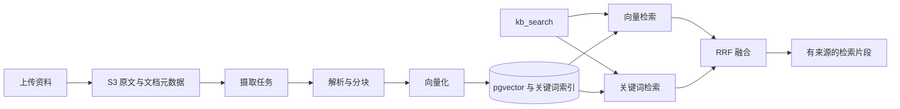

# xa 产品蓝图

本文定义产品目标、演示场景和后续能力边界。当前完成状态与开发顺序统一见 [路线图](ROADMAP.md)，真实模块结构见 [当前架构](architecture.md)。

## 1. 产品定位

xa 是个人 Agent 平台。用户注册后拥有主 Agent，可以按人格、模型和工具配置创建专职 Agent。公共 Agent 由管理员维护，各使用者的会话、记忆和运行记录独立。英语口语教练通过平台能力和配置实现，不建立另一套运行系统。

人格以 `soul.md` 随版本保存，记忆以结构化条目持久化；知识库是独立的资料检索系统。每轮运行保留实际配置版本、上下文、工具调用、token 和耗时，支持查看过程和追溯来源。

## 2. 演示场景与验收目标

以下是完整产品目标，不代表所有场景已经实现；完成状态以路线图为准。

| 场景 | 操作 | 验收重点 |
| --- | --- | --- |
| S1 主 Agent 记得我 | 注册，告知姓名与学习目标；早期消息离开历史窗口后再询问；从对话记忆面板修改条目，再继续对话；创建另一 Agent 读取共享资料 | 召回来源可追溯；用户编辑通过取代链生效；共享 profile 可读，私有记忆不泄露 |
| S2 文本版口语教练 | 创建教练，上传并绑定题库；根据资料出题、作答、评分与纠错；之后继续对话复习到期错题 | 命中资料可查；评分含维度和理由；错题独立存储，FSRS 产生并更新 `due_at`；不对文本生成发音评分 |
| S3 运行追踪 | 打开当前用户一轮运行的详情，查看上下文、模型调用、工具结果与审批过程 | 能核对 span 层级、状态、token、耗时和脱敏摘要；RAG 上线后扩展检索片段与分数；不开放他人私人 trace |
| S4 知识库质量 | 查看文档切片，输入问题对比向量、关键词和混合检索，再执行小评测集 | 可查看切片大小、重叠与来源；输出 recall@5 和 MRR |
| S5 主 Agent 委派 | 主 Agent 接到学习进展问题后委派教练；教练读取自己的记录，返回结论并提交共享候选 | 子 Agent 不继承父对话历史；主 Agent 不读取教练私有记忆；委派树可查；共享结论经候选流程处理 |
| S6 记忆评测 | 使用 50–100 段多会话剧本测试更新、时间推理、多会话汇总、拒答与隔离投毒，再做消融实验 | 报告各类正确率、隔离泄露率、投毒写成 active 的比例、token 与延迟；隔离和投毒以零泄露、零直接污染为验收目标 |

## 3. 运行与上下文

当前运行内核是 `agent/run.NativeEngine`。模型适配器只向引擎暴露中立消息、工具调用和流事件；工具注册、配置解析、授权、预算、审批和持久化由平台管理。

同一用户与同一 Agent 保持一条连续对话。每轮读取当前版本，运行保存实际 `agent_version_id`，配置更新不改变已有运行。Context Builder 按预算组装平台规则、SOUL、核心记忆、检索记忆、可用模块、摘要、历史和当前输入。工具协议历史与用户可见消息分开保存。

SSE v2 支持文本、工具、审批、记忆更新和运行终态；默认 v1 保持兼容。断线使用事件序号恢复，主动停止通过取消接口处理。运行机制和验收要求见 [工具循环设计](agent-loop-design.md)。

## 4. 记忆与共享边界

### 已实现的基础

- `memory_items` 是事实来源，`memory.md` 与 profile 为按预算生成的视图。
- 主 Agent 写 user 层，专职 Agent 写自身 agent 层；user 层供当前用户的 Agent 读取，agent 层限制对应 Agent，session 层限制会话。
- 用户编辑记为 `user_edited` 并取代旧条目，自动抽取不能覆盖用户编辑；来源和操作保存在取代链与事件中。
- 召回先用 HNSW 取得候选，再结合相关性、importance 和 retention 排序；敏感条目不进入默认自动召回。
- token 历史窗口与滚动摘要控制长对话体积；worker 执行抽取、摘要重写、归档维护和重复事实合并。
- 遗忘影响排序和归档，不物理删除事实。用户主动删除与自动遗忘分别处理。

参数、任务重试、状态与当前接口详见 [记忆 v2](memory-v2.md) 和 [记忆 API](api/memory.md)。

### 委派阶段扩展

- 非主 Agent 向 user 层写入的内容必须先成为候选；不能因委派或父 Agent 身份扩大写权限。
- 外部文档和工具返回文本只作为数据，不能修改权限、SOUL 或直接成为共享事实。
- 冲突处理保留来源、有效期和取代链；低可信来源不能覆盖用户明确编辑的事实。
- 候选确认、拒绝、冲突展示以及共享授权在委派阶段形成独立设计和验收。

记忆研究、候选权限矩阵、评测分类和公式推导见 [记忆与多 Agent 研究](memory-multiagent.md)。其中的 DDL 与伪代码用于讨论，不替代当前迁移和实现。

## 5. 知识库 RAG

知识库、文档和切片分别保存元数据；原文保存在 S3。计划支持文本、Markdown 和 PDF，解析使用成熟库，具体格式与限制在 RAG 任务中确认。切片按标题、段落及 token 窗口组织，保留序号、来源、大小和重叠；文档处理显示 pending / processing / ready / failed 状态与可理解的失败原因。

向量使用 1024 维 embedding 与 pgvector HNSW，关键词检索补充专有名词及题号，再通过 RRF 融合。只检索当前 Agent 已绑定且调用者有权访问的知识库。资料中的指令不能作为平台规则执行。

摄取任务与元数据写入保证一致，worker 处理解析、切片和向量化，使用 checksum 识别重复资料。修改切分或 embedding 配置后的重建规则在 RAG 设计中明确。评测先比较向量、关键词与混合检索；仅在指标证明排序不足后评估 rerank。

用户端提供上传、处理状态和绑定入口；管理端提供切片与检索测试。验收使用真实存储、向量服务和后端，输出 recall@5、MRR。

## 6. 文本版口语教练与 FSRS

教练以 SOUL 定义考官人格和评分标准，通过知识库检索出题，按维度给出分数、理由和纠错证据。文本输入只评价文本可支持的维度。

错题卡片与聊天记忆分表，计划使用 `coach_review_items` 和 `coach_review_logs` 保存错误类型、原句、修正、来源、FSRS 状态、到期时间和复习结果。使用 go-fsrs 计算复习间隔；按到期时间抽取卡片编入下一次练习，再根据表现更新状态。

验收覆盖“上传资料 → 出题 → 作答 → 评分 → 错题记录 → 到期复习”。通用评价后台和语音接入仍在 Icebox。

## 7. 主 Agent 委派

以 `ask_agent` 工具接入现有运行机制，具体实现另行设计，不预设 Eino 依赖。父 Agent 保留控制权，子 Agent 只接收任务描述和简短 note，不继承父对话完整历史。note 不授予权限，建议限制在 100 词以内。

子运行记录父运行 ID 与委派深度，深度上限不超过 2；管理端显示委派树。子 Agent 按自己的记忆权限运行，返回结果不等于授权父 Agent 直接读取其私有记忆。需要进入用户共享层的结论先提交候选。

不实现自由群聊或无限递归。验收覆盖越权、深度限制、父子状态、失败传播与共享候选流程。

## 8. 技术与交付约束

| 项目 | 当前选择或规划边界 |
| --- | --- |
| 服务端 | Go、net/http、Huma v2、NativeEngine |
| 模型 | 阿里百炼 OpenAI 兼容适配；默认主模型 `qwen3.7-plus`，轻量任务和测试 `qwen3.8-flash`；实际配置以服务端为准 |
| Embedding | `qwen3.7-text-embedding`，1024 维；更换模型需明确索引重建 |
| 存储 | PostgreSQL / pgvector、Redis、S3 兼容存储；本地使用仓库声明的 Compose |
| 前端 | React 19、管理端 Umi 4、用户端 Umi Max 4、Tailwind CSS、Radix UI、Lucide；管理端表格使用 TanStack Table |
| 接口 | Go 生成 OpenAPI 与普通 JSON 客户端；SSE 保留专用处理 |
| 迁移与任务 | 独立迁移命令；当前记忆队列为 PostgreSQL `memory_jobs`，RAG 摄取队列另行设计 |
| 观测 | `runs` / `run_spans` 和脱敏结果；不默认引入额外观测平台 |

每期独立分支、一个 PR，独立验收后由验收方 squash 合并。新页面或明显视觉改版先确认设计，交付附真实截图。集成测试与浏览器验收使用真实依赖；文档修改只检查内容、链接和差异。

收尾交付包含启动与部署说明、架构图、S1–S6 演示录屏与答辩材料。部署目标、是否需要移动端或语音由单独需求确定，不把它们作为当前已承诺功能。
