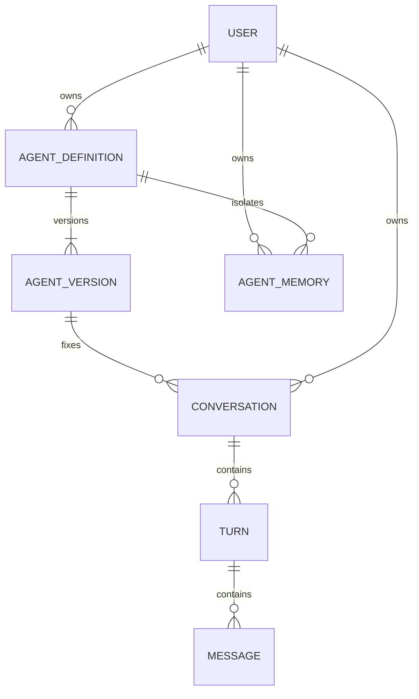

# 领域与接口约定

本文定义业务实现必须遵守的约束。当前仅有类型和接口，业务表、鉴权和路由在后续批次实现。

## 1. 核心数据关系

| 数据 | 必须满足的约束 |
| --- | --- |
| AgentDefinition | workspace_id、owner_id、owner_type 必填；current_version_id 必须属于本 Agent；普通用户只能创建私有 Agent |
| AgentVersion | 同一 Agent 的 version_number 唯一；完整配置和绑定不可变，不包含用户数据及密钥 |
| Conversation | user_id 为使用者；固定的 agent_version_id 必须属于 agent_id；公共 Agent 不改变会话归属 |
| Turn | conversation_id + request_id 唯一；同会话最多一条 running 轮次；终态不能变回 running |
| Message | 从属会话和轮次，记录正文、录音引用及完成标记；工具结果保留调用标识 |
| AgentMemory | 按 workspace_id + user_id + agent_id + namespace 隔离；保留来源，用于删除和追溯 |

工作空间和身份由认证结果确定。会话查询总是限制当前 user_id，管理员角色不取消此限制。私有 Agent 查询限制 owner_id；公共 Agent 使用权不包含修改配置权。

## 2. 配置保存

`POST /api/v1/agents` 提交名称、可见范围和完整配置；`PUT /api/v1/agents/{agent_id}/config` 提交更新后的完整资料、配置和 expected_version_id。创建者身份不接受客户端指定。

1. 检查调用者对 Agent 的管理权及绑定资源的使用权。
2. 校验提示词、模型能力、工具、知识库、评价配置和运行限制。
3. 事务内写入新版本及绑定，比较 expected_version_id，更新定义的当前版本指针。
4. 失败则整体回滚；并发修改返回 409，客户端重新读取后再决定保存。

首次成功保存返回 201，更新返回 200，并返回 agent_id、current_version_id 和状态。定义启停与版本配置分开：保存停用 Agent 的配置仍保持停用。

停用、删除、撤销权限时，先更新持久化状态，再通知当前执行取消。每次模型调用和工具执行前重新检查限制；取消不可撤销已经提交的工具写入，必须保留真实结果。删除 Agent 不级联删除使用者历史。

## 3. 会话与请求

| 操作 | 输入与行为 |
| --- | --- |
| 创建会话 | 客户端只提交 agent_id；服务端校验可用性，绑定当前版本和当前用户 |
| 发送文本 | 提交 request_id 和 message；服务端加载固定版本、历史、记忆和工具目录 |
| 重复请求 | 相同 request_id、相同内容返回已有轮次；内容不一致返回 409，不重复执行工具 |
| 通道占用 | 有其他文本轮次或实时连接占用时返回 409；取消并确认结束后才允许切换 |
| 取消 | 幂等终止当前运行，保留已产生内容及 canceled 状态 |
| 读取历史 | 仅会话所有者可读，Agent 已删除时仍可只读访问 |
| 删除会话 | 先使会话不可运行，再清理专属对象、评价和仅来源于该会话的记忆；任务执行前检查删除标记 |

PostgreSQL 的唯一约束负责请求去重和 running 轮次互斥。Realtime 连接在空闲轮次之间仍持有会话执行租约，Redis 用于租约、取消通知和短期事件；租约失效必须终止执行。工具写入使用稳定调用标识去重，不能依靠模型再次生成相同调用。

API 错误使用 `{ "code": "...", "message": "...", "request_id": "..." }`。未登录返回 401，无操作权限返回 403，不存在或不对当前用户可见的资源返回 404，并发或版本冲突返回 409，配置或能力不支持返回 422，依赖不可用返回 503。响应不包含凭证和供应商原始错误。

## 4. 文本与实时协议

文本使用 `AgentRunner.Run`，返回平台事件；Realtime 使用 `RealtimeRunner.Open`，获得 Send、Events、Close。`infra/realtime.Provider` 只负责上游连接，工具执行由平台接收调用事件后统一授权，再通过 SubmitToolResult 返回结果。

- 文本使用 SSE，客户端根据事件 id / sequence 去重。已确认消息和轮次结果以数据库为准；超出短期事件保留范围时重新读取历史。
- 实时连接通过 WebSocket，输入类型包括音频追加、输入确认、打断和播放进度确认。客户端不能提交工具结果或其他用户的运行上下文。
- 音频编码、采样率和声道由配置与供应商能力共同校验，打开连接时返回协商结果；不承诺所有厂商使用同一音频格式。
- Realtime 连接可承载多个轮次。平台 turn_id 标识每轮，供应商 response_id 仅用于当前连接内的响应映射。
- 打断时使用 response_id 和已播放时长停止生成、清空待播放音频并裁剪上下文。没有播放确认的部分不计入已交付内容。
- 每条事件包含 id、request_id、conversation_id、可选 turn_id、sequence、data 和 occurred_at；sequence 在同一平台事件流内递增。
- 连接关闭后事件通道关闭、执行租约释放；断线窗口和音频参数在具体供应商接入时验证，不模拟恢复供应商内部状态。

## 5. 实现时的验证

业务功能验收包含：普通用户越权访问被拒绝；公共 Agent 用户之间数据隔离；保存失败不产生半成品；并发保存不覆盖更新；旧会话固定版本；停用立即取消；重复请求不重复写入；文本和实时通道互斥；打断后的未播放内容不进入已交付历史。验证使用真实数据库、真实模型和真实音频。
