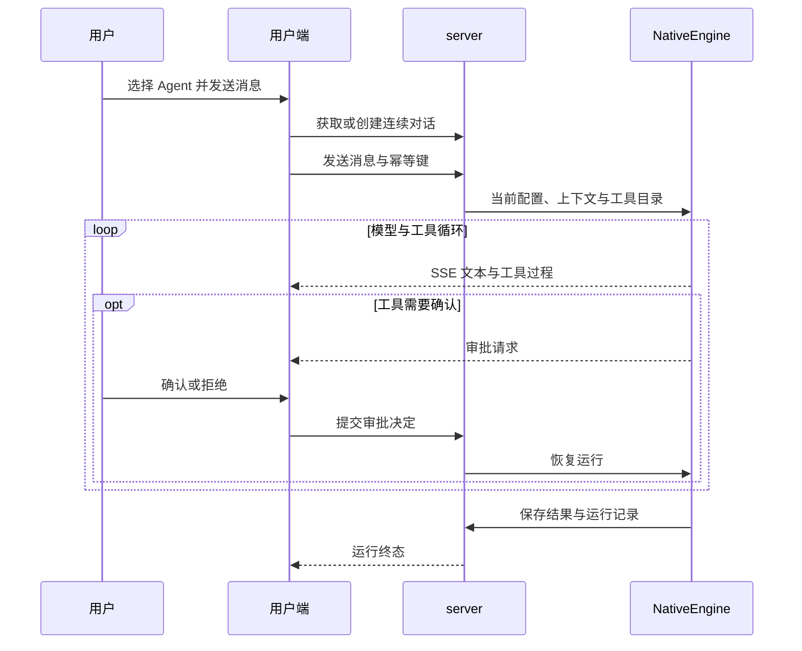

# 产品流程

## 账号与 Agent

用户可以匿名浏览公共 Agent；创建私有 Agent、发送消息和读取私人数据需要登录。注册自动创建不可删除的主 Agent，普通用户只管理自己的私有 Agent，管理员维护公共 Agent。

公共 Agent 共享人格和能力配置，每个使用者的会话、记忆和运行记录分别归属本人。

## 配置与版本

用户在对话右侧查看 Agent 资料、SOUL、模型、工具与记忆，管理端使用整页配置。保存生成不可变版本，通过 `expected_version_id` 检查并发修改；冲突时重新读取配置。

同一用户与同一 Agent 使用一条连续对话。配置更新作用于后续轮次，运行记录保留当轮实际使用的版本。公共 Agent 在普通用户端只读，停用和归属限制由服务端执行。

## 文本对话

用户可停止生成，已经生成的内容保留；刷新或短暂断线后，页面读取已有消息和活动运行并尝试恢复事件流。历史在当前 Agent 对话内向上分页加载。

## 记忆与运行记录

对话可通过记忆工具主动查询、写入和删除记忆，worker 在后台处理抽取、摘要和维护。用户在记忆面板查看、编辑、删除条目，查看归档并恢复条目，以及处理失败任务。关闭记忆后停止对应记忆读取和抽取，已有数据保留。

工具操作是否需要确认由配置与服务端规则决定。用户端显示审批及工具结果；管理端提供只读确认记录和运行追踪，查看上下文、模型调用、工具结果、token 与耗时，查询仍限制当前用户归属。

知识库、文本版口语教练、FSRS 复习和主 Agent 委派的交付顺序与验收目标见 [路线图](ROADMAP.md) 和 [蓝图](blueprint.md)。
